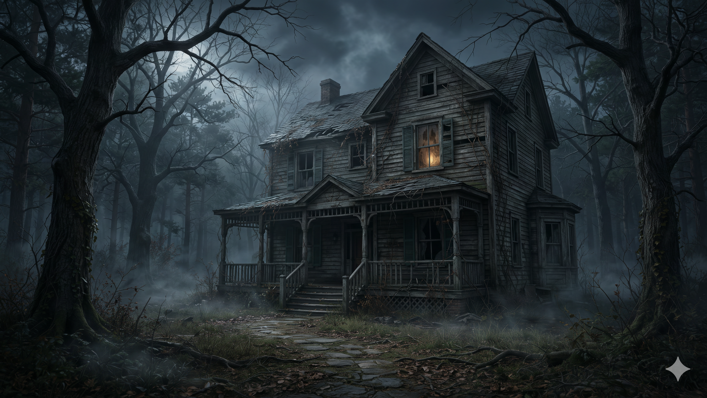
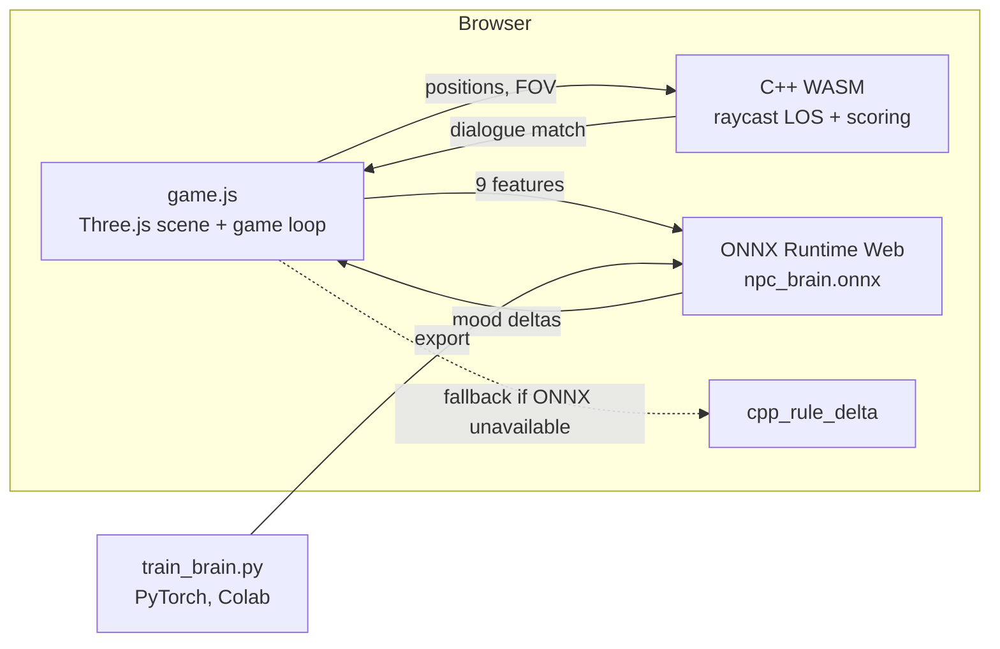

# 🏚️ The Woods House

**A first-person horror stealth game that runs entirely in your browser: no backend, no install.**
Sneak upstairs, steal three artifacts, and escape before the homeowners catch you. Their reactions are driven by a C++ WebAssembly engine and a small neural network trained in PyTorch and served in-browser through ONNX.

**[▶ Play in your browser](https://huggingface.co/spaces/tempestanzar/the-woods-house)** · Desktop browser, keyboard + mouse · Headphones recommended·

<p align="center">
  <a href="https://drive.google.com/file/d/1n3I80K8V4BjSLUWSWB-K3ONMVGRilF4K/view?usp=drive_link">
    
  </a>
</p>

<p align="center">
  <a href="https://drive.google.com/file/d/1n3I80K8V4BjSLUWSWB-K3ONMVGRilF4K/view?usp=drive_link">🎬 Watch the gameplay video</a>
</p>

> **Content note:** horror themes, implied violence (knife attack animation), and flashing red alarm lighting during Lockdown.

---

## Why this project exists

This is an **applied ML engineering** portfolio piece. The goal was to ship a *complete* ML-in-the-loop system under real constraints, not just train a model:

| Constraint | How it was handled |
| :--- | :--- |
| **Zero backend** | Inference runs client-side via `onnxruntime-web`; spatial math runs in WASM |
| **Integrated GPUs (Intel Iris Xe)** | Frame-rate-independent (`dt`) simulation, lightweight scene, small model |
| **Model might fail to load** | Deterministic C++ rule set doubles as a fallback, so the game never hard-crashes |
| **Python → browser handoff** | PyTorch → single-file ONNX (no external data) → `onnxruntime-web` |

---

## How it works



### 1. C++ WebAssembly engine (`house_engine.cpp` → `house_engine.wasm`)

Compiled with Emscripten (`-O3`) and called from JS through `cwrap`.

- **Wall-occluded line of sight** (`cpp_has_los`, `cpp_is_spotted_los`): 3D AABB slab raycasts against walls and tall furniture, plus a forward FOV cone. NPCs and flashlight detection don't trigger through walls.
- **Dialogue scoring** (`cpp_euclidean_score`): L2 distance between an NPC's live `[Trust, Curiosity, Aggression]` vector and each candidate line's mood vector.
- **Rule-based mood deltas** (`cpp_rule_delta`): drives Games 1–4, and acts as the fallback if the ONNX model can't load or inference throws.

### 2. Neural NPC brain (`train_brain.py` → `npc_brain.onnx`)

From **Game 5** onward (or via the Dev toggle in the status bar), a small MLP replaces the fixed rules.

- **Architecture:** `9 → 48 → 32 → 3` (ReLU hidden layers, Tanh output to bound mood shifts)
- **Inputs (9):** danger-zone flag · stolen-artifact ratio · player stealth (standing/crouched) · dialogue choice (Bluff / Charm / Intimidate) · current Trust · Curiosity · Aggression · NPCs-noticed-missing-item flag · player-absent-from-Floor-1 flag
- **Outputs (3):** `dTrust`, `dCuriosity`, `dAggression`
- **Training data:** 12,000 synthetic encounters generated from a hand-authored behavioral model, with noise added. The model reached **< 0.0005 MSE** on this dataset.
- **Deployment:** exported as one self-contained `.onnx` file and run with `onnxruntime-web` (`numThreads = 1`, since Static Spaces aren't cross-origin isolated).

### 3. A confrontation, end to end

1. An NPC gets line of sight (WASM) while you're upstairs or in Lockdown.
2. You pick **Bluff**, **Charm**, or **Intimidate** (each shows a fresh variant so lines don't repeat).
3. Rules (Games 1–4) or the ONNX model (Game 5+) return mood deltas, clamped to `[0, 1]`.
4. WASM scores every choice-compatible NPC line against the new mood; the closest unused line is spoken.
5. **Aggression hits 100%** → knife attack. **Curiosity hits 100%** → they call the police.

---

## Gameplay

- **Two-floor navigation graph:** BFS pathfinding across rooms and the staircase.
- **Mutual-exclusion patrols:** only one NPC can check Floor 1 at a time, so Floor 2 is never left unguarded. The solo upstairs NPC tightly patrols the remaining un-stolen artifacts. If the NPC checking Floor 1 doesn't find you downstairs, their Curiosity spikes.
- **Noisy artifact grabs:** stealing an item alerts the upstairs NPC, who immediately investigates that room.
- **Missing-item detection:** NPCs notice stolen artifacts, whisper to each other about it, and start guarding what's left.
- **Stealth, light and sound:** crouch to silence footsteps and shrink detection range; avoid shining the flashlight at NPCs; creaky floorboards draw them toward you.
- **Lockdown ambush:** once all 3 artifacts are stolen, the house goes red. Arthur sprints to block the Main Door and stairs, while Eleanor actively re-tracks your nearest navigation node every 1.5 seconds. Escape through the Main Door.
- **Difficulty:**

| Mode | NPC speed | Escape strikes | Flashlight detection |
| :--- | :--- | :--- | :--- |
| Easy | Slow | 2 | Off |
| Normal | Medium | 2 | On |
| Nightmare | Fast | 0 (one catch is fatal) | On, plus item guarding |

### Controls

| Input | Action |
| :--- | :--- |
| Mouse | Look |
| `W A S D` / Arrows | Move |
| `Shift` | Crouch (silent steps, smaller detection range) |
| `Space` | Jump |
| `F` | Toggle flashlight |
| `E` | Steal artifact / open Main Door during Lockdown |
| `Esc` | Pause / release cursor |

---

## Tech stack

**Rendering:** Three.js r128 (WebGL), GLTFLoader, Mixamo characters (idle / stalk / stabbing clips)
**Logic:** vanilla JavaScript, C++17 → WebAssembly (Emscripten)
**ML:** PyTorch → ONNX (opset 14) → `onnxruntime-web`. The 9-feature MLP reached < 0.0005 MSE on 12,000 synthetic encounters and runs smoothly on integrated graphics (Intel Iris Xe).
**Audio:** 38 voice clips generated offline with `edge-tts` (`en-GB-RyanNeural`, `en-GB-SoniaNeural`) and processed with `ffmpeg` (pitch drop, slowdown, reverb), plus procedural WebAudio for footsteps, creaks, heartbeat and slashes
**Build:** Google Colab for training, audio synthesis and WASM compilation. The shipped game is static files only.

---

## Repository structure

```text
├── index.html            # UI overlays: menus, HUD, dialogue, pause, end screens
├── game.js               # Scene, nav graph, game loop, WASM + ONNX bridge
├── dialogues.json        # Player options, mood-tagged NPC lines, whispered meetings
├── house_engine.cpp      # C++ source: raycast LOS, Euclidean scoring, rule deltas
├── house_engine.js/.wasm # Emscripten build output
├── npc_brain.onnx        # Trained NPC model (single file)
├── train_brain.py        # Data generation, training, ONNX export (Colab-ready)
├── LICENSE               # MIT
└── assets/
    ├── audio/            # Voice clips (Arthur, Eleanor, meetings)
    ├── models/           # Mixamo GLB characters and animation clips
    └── textures/         # Wallpaper, floor, ceiling, title background
```

---

## Run locally

WebAssembly and ONNX need HTTP, not `file://`:

```bash
python -m http.server 8000
# open http://localhost:8000
```

**Rebuild the WASM engine** (requires the [Emscripten SDK](https://emscripten.org/)):

```bash
em++ house_engine.cpp -O3 -o house_engine.js \
  -sEXPORTED_RUNTIME_METHODS=cwrap -sALLOW_MEMORY_GROWTH=1
```

**Retrain the NPC model:**

```bash
pip install torch numpy onnx
python train_brain.py   # writes npc_brain.onnx
```

---

## Limitations and honest notes

- **The model is distilled from a hand-written simulator**, not learned from real player data. It learns smooth, context-dependent mood responses, but it can't discover behavior nobody encoded.
- **Navigation is a hand-authored graph.** NPCs follow it and don't dynamically avoid obstacles.
- **Voice clips are pre-rendered**, so NPC speech is selected from a fixed set, not generated at runtime.
- Tested primarily on desktop Chromium; mobile and touch controls aren't supported.

---

## Credits and licenses

- Characters and animations: [Mixamo](https://www.mixamo.com/) (Adobe), subject to Mixamo's terms of use
- Voices: Microsoft Edge neural TTS via [`edge-tts`](https://github.com/rany2/edge-tts)
- Libraries: [Three.js](https://threejs.org/) (MIT), [ONNX Runtime Web](https://onnxruntime.ai/) (MIT), [Emscripten](https://emscripten.org/) (MIT/UIUC)
- Textures: `menu_bg.jpg` is AI-generated title artwork; `wallpaper.jpg`, `wood_floor.jpg`, and `ceiling.jpg` are seamless architectural textures

Code released under the [MIT License](LICENSE).

Built by **Mohd Anzar** ([@anzar-hue](https://github.com/anzar-hue)).