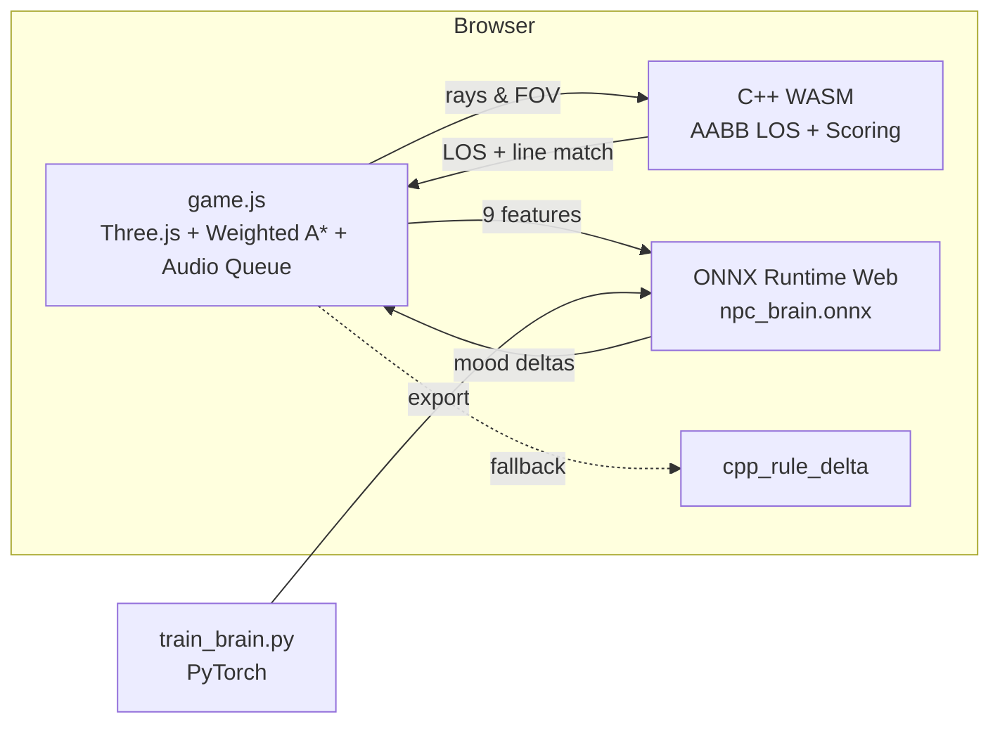

# 🏚️ The Woods House

**A 3D first-person horror stealth game running 100% client-side in the browser—no backend, no install.**  
Sneak upstairs, steal five artifacts, and escape before Arthur and Eleanor catch you. Perception and scoring run in **C++ WebAssembly**, while adaptive NPC moods are driven by a **PyTorch neural network (ONNX)**.

[**▶ Play Live**](https://huggingface.co/spaces/tempestanzar/the-woods-house) · [**🎬 Gameplay Demo**](https://drive.google.com/file/d/1n2BcQOkjVJcbTLNcrdnQyYp8VHgD3ZJJ/view?usp=drive_link) · Desktop (Mouse + Keyboard) · Headphones recommended

> **Content note:** Horror themes, knife attack animation, and flashing red alarm lighting during Lockdown.

## Architecture & Engineering Highlights

| Layer | Implementation |
| ----- | ----- |
| **3D Engine & UI** | Three.js r128, Mixamo GLB characters (cached once on load), shared Lambert decor props, gothic HUD, **60 FPS on Intel Iris Xe** |
| **C++ WebAssembly** | Emscripten (`-O3`) 3D AABB raycast line-of-sight (`cpp_has_los`, `cpp_is_spotted_los`), wall-attenuated sound (~50% dampening), Euclidean dialogue matching (`cpp_euclidean_score`), and deterministic rule fallback (`cpp_rule_delta`) |
| **PyTorch → ONNX AI** | 9-feature MLP (`9 → 48 → 32 → 3`, ReLU + Tanh) trained on 12k synthetic encounters (< 0.0005 MSE), exported as a single `.onnx` file via `onnxruntime-web` (`numThreads = 1`) |
| **Live Telemetry** | Press `Tab` in-game to inspect live FPS, draw calls, C++ raycast LOS, 9-feature ONNX input tensor, and mood deltas |
| **Audio Pipeline** | 51+ horror-processed neural voice clips (`edge-tts` + `ffmpeg` pitch/reverb) with a priority-based voice queue, menu & lockdown soundtracks, and procedural WebAudio SFX |



### How NPC AI Works
* **Games 1–4:** Deterministic C++ WASM rules govern mood shifts (`Trust`, `Curiosity`, `Aggression`).
* **Game 5+ (or Dev Toggle):** The PyTorch ONNX model takes 9 live features (danger zone, stolen ratio, stealth state, dialogue choice, current mood, missing-item awareness, floor-1 absence) and outputs bounded mood deltas.
* **Consequences:** `Trust` scales incoming aggression; **100% Aggression** triggers a fatal knife attack, and **100% Curiosity** calls the police.

## Core Gameplay

* **One-Time Welcome Cutscene (Game 1):** First-time players get a voice-synced front-door intro with a blink-to-black transition (`Space` to skip). Subsequent runs drop straight into the ground floor.
* **Weighted A\* & Mutual-Exclusion Patrols:** Two-floor navigation graph. Only one NPC checks Floor 1 at a time while the other guards remaining artifacts upstairs.
* **Hiding & Stealth:** Hide (`E`) in the **Guest Room Wardrobe**, **Under the Study Desk**, or **Behind NW Crates**—getting seen ducking in triggers an immediate confrontation (`+20% Curiosity`). Includes a **Visibility Gem**, **Q/Z Corner Lean**, **Proximity Flashlight Flicker**, and **Staircase Warnings** (`+4% Curiosity`, 15s cooldown).
* **Lockdown Ambush:** Stealing all **5 artifacts** (`Silver Key`, `Secret Ledger`, `Gold Locket`, `Pocket Watch`, `Family Photo`) triggers chase music and red alarm lighting. Arthur blocks the Main Door while Eleanor actively re-tracks your position every 1.5s.
* **Voiced Ending Cutscenes:** Custom first-person **Death** (floor POV) and **Police Arrest** (animated siren overlay) cutscenes with synchronized dialogue.
* **Local Save/Load System:** Mid-run save and resume support with a Pause-menu save prompt and in-game 2-step reset to Game 1.

### Difficulty & Controls

| Mode | NPC Speed | Lockdown Strikes | Flashlight Detection |
| ----- | ----- | ----- | ----- |
| **Easy** | Slow | 2 | Off |
| **Normal** | Medium | 2 | On |
| **Nightmare** | Fast | 0 (1 catch = fatal) | On + Item Guarding |

`WASD` Move · `Mouse` Look · `Shift` Crouch · `Q`/`Z` Lean · `Space` Jump / Skip Intro · `F` Flashlight · `E` Steal / Hide / Escape · `Tab` AI Telemetry · `Esc` Pause

## Save Progress & Reset to Game 1

* **Save & Continue:** Press `Esc` during gameplay → **Logout / Exit to Menu** → **Yes, Save & Exit** to store your mid-game progress (collected items, positions, and NPC moods). Progress is saved locally per device/browser via `localStorage`.
* **Reset to Game 1:** Click **Reset to Game 1** on the Title Screen (with two-step confirmation) to wipe your saved run, reset the Game Count, and replay the voiced Game 1 intro cutscene.

## Run Locally

WebAssembly and ONNX require HTTP (not `file://`):

```bash
python -m http.server 8000
# open http://localhost:8000
```

**Rebuild WASM:**
```bash
em++ house_engine.cpp -O3 -o house_engine.js -sEXPORTED_RUNTIME_METHODS=cwrap -sALLOW_MEMORY_GROWTH=1
```

**Retrain Model:**
```bash
pip install torch numpy onnx
python train_brain.py
```

## Notes & Credits

* **Scope:** The ONNX brain is distilled from a hand-authored behavioral simulator; navigation uses a fixed 2-floor node graph; voice clips are pre-rendered.
* **Credits:** [Mixamo](https://www.mixamo.com/) characters/animations · [`edge-tts`](https://github.com/rany2/edge-tts) voices · [Three.js](https://threejs.org/) · [ONNX Runtime Web](https://onnxruntime.ai/) · [Emscripten](https://emscripten.org/).

Released under the [MIT License](LICENSE) · Built by **Mohd Anzar** ([@anzar-hue](https://github.com/anzar-hue)).